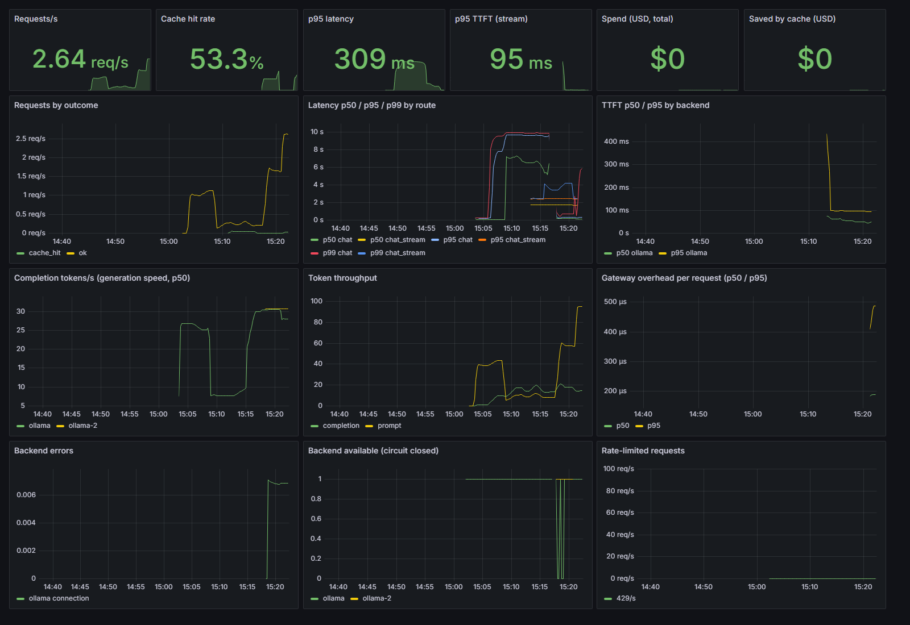

# Production LLM Inference Gateway

An OpenAI-compatible gateway in front of vLLM/Ollama (and optional hosted APIs). It handles routing, caching, rate limiting, fallback, and cost tracking, with full observability.

> Part of the Live Projects portfolio. See [SHARED_STANDARDS.md](../SHARED_STANDARDS.md) for conventions and the milestone definition of done.

## Overview

Applications that call LLMs directly end up re-implementing auth, retries, caching, and
cost tracking in every service. This gateway puts all of that behind one
**OpenAI-compatible endpoint**. Any OpenAI SDK or HTTP client works unchanged, including
the [Healthcare RAG](../02-healthcare-rag/) project. Requests can go to local models
(Ollama on your GPU, vLLM) or to a hosted provider.

**What it does today**

| Feature | How |
|---|---|
| OpenAI-compatible API | `POST /v1/chat/completions` (JSON + SSE streaming), `POST /v1/embeddings`, `GET /v1/models` |
| Auth | Bearer API keys (`GATEWAY_API_KEYS`), constant-time comparison; with no keys configured, every request is rejected |
| Per-tenant rate limiting | Fixed one-minute window per API key in Redis (`INCR` + `EXPIRE`), shared across replicas, with a `Retry-After` header |
| Routing policies | `cost` (cheapest $/1K tokens), `latency` (lowest observed EWMA latency), `quality` (highest configured score) |
| Reliability | Retries with exponential backoff, fallback to the next backend, and a per-backend circuit breaker. Streams fall back only until the first token arrives. Bad requests (400/413/422) go straight back to the client, without retries. |
| Model aliasing | Maps a public model name to each backend's own name, e.g. `llama3.2` → `llama3.2` on Ollama and `llama-3.1-8b-instant` on Groq, so fallback works across providers |
| Response cache | Exact-match Redis cache keyed by a SHA-256 of the canonical request. Modes: `all`, `deterministic`, `off`. `Cache-Control: no-cache` bypasses it. |
| Cost tracking | Token usage from the backend, or estimated if the backend doesn't report it, times $/1K pricing per backend. The cost of each request goes in the `x-gateway-cost-usd` header. |
| Guardrails | PII redaction (email, phone, SSN, credit card with a Luhn check, IP address) on prompts and responses, and prompt-injection detection (5 rule families). Each can be off, flag/redact, or block; see [Guardrails](#guardrails) |
| Resilience | If Redis goes down, cache and rate limiting are skipped (fail open) instead of failing requests |
| Metrics | Prometheus `/metrics`: requests by outcome, latency histograms, TTFT, tokens/s, tokens, spend, cache hits and savings, backend errors, breaker state |
| Dashboards | A provisioned Grafana dashboard (15 panels), including the gateway's per-request overhead |

Every response carries `x-gateway-backend`, `x-gateway-cache` (`HIT`/`MISS`/`BYPASS`),
`x-gateway-cost-usd` and `x-gateway-latency-ms` headers, plus `x-gateway-guardrails` (e.g.
`pii_email=1,injection=ignore_instructions`) when a guardrail fires.

### Guardrails

Guardrails are rule-based and run in-process before the model call, so they add no extra
model round trip.

| Setting | Values (default **bold**) | Effect |
|---|---|---|
| `GUARDRAIL_PII` | off, **redact**, block | Replaces PII in every message with `[REDACTED_<KIND>]` before routing, caching and logging. `block` rejects the request with 400 `guardrail_violation` instead. |
| `GUARDRAIL_OUTPUT_PII` | off, **redact** | Redacts PII in non-streaming model answers. Streaming answers are not redacted, because an entity can be split across chunks. |
| `GUARDRAIL_INJECTION` | off, **flag**, block | Checks user and tool messages (not the system prompt) against 5 rule families: ignore-instructions, reveal-system-prompt, role override, jailbreak keywords, chat-template delimiters. `flag` adds a header and a metric; `block` returns 400. |

Every event is counted in `llmgw_guardrail_events_total{direction,kind,action}`, and the time
spent in `llmgw_guardrail_seconds`.

**Limits:** regexes miss unusual PII formats, and the injection rules catch common phrasings,
not every adversarial prompt. A second-stage ML classifier could catch more, at the cost of
added latency. Embedding requests aren't guarded, so RAG documents keep their original text.

## Tech Stack

| Layer | Tools |
|---|---|
| API | FastAPI (async), Uvicorn, httpx |
| Cache / rate limits | Redis 7 |
| Model backends | Ollama (native, GPU), vLLM, any OpenAI-compatible hosted API (e.g. Groq) |
| Observability | Prometheus, Grafana |
| Load testing | `scripts/bench.py` (async httpx: p50/p95/p99, TTFT, throughput) |
| Infra | Docker, Docker Compose, GitHub Actions |

## Architecture

| Component | Module | Responsibility |
|---|---|---|
| **API layer** | `main.py` | OpenAI-compatible routes, validation, SSE streaming, OpenAI-style errors |
| **Auth & rate limiter** | `main.py`, `ratelimit.py` | API-key check, per-tenant limit in Redis |
| **Cache** | `cache.py` | Exact-match response cache in Redis |
| **Router** | `router.py` | Ranks backends by policy; retries, fallback, circuit breaker |
| **Backend adapter** | `backends.py` | One httpx client per OpenAI-compatible upstream; maps errors to retryable or client errors |
| **Telemetry** | `metrics.py` | Prometheus metrics, token accounting, cost |
| **Config** | `config.py` | `pydantic-settings` from env / `.env`; builds the backend list |

```
          clients (curl, OpenAI SDKs, 02-healthcare-rag)
                         │  OpenAI-compatible HTTP + Bearer key
                         ▼
┌──────────────────────────────────────────────────────────────┐
│                    LLM Gateway (FastAPI)                     │
│                                                              │
│  auth ─► rate limit ─► cache lookup ──hit──► response        │
│            │               │ miss                            │
│            ▼               ▼                                 │
│          Redis ◄──── router: rank by policy ─► retry ─►      │
│        (counters,     fallback ─► circuit breaker            │
│         cache)            │                                  │
│  /metrics ─► Prometheus ─► Grafana                           │
└───────────────────────────┼──────────────────────────────────┘
              ┌─────────────┼──────────────────┐
              ▼             ▼                  ▼
         vLLM server   Ollama (GPU)    hosted API (Groq, ...)
```

## Setup

### Prerequisites
| Tool | Install (Windows) | Check |
|---|---|---|
| Python 3.11 | `winget install -e --id Python.Python.3.11` | `py -3.11 --version` |
| WSL2 (needed by Docker) | `wsl --install` in an admin PowerShell, then reboot | `wsl --status` |
| Docker Desktop | `winget install -e --id Docker.DockerDesktop` | `docker run --rm hello-world` |
| Ollama | `winget install -e --id Ollama.Ollama` | `ollama list` |
| Models | `ollama pull llama3.2`, `ollama pull llama3.2:1b`, `ollama pull nomic-embed-text` | `ollama list` |
| GNU Make (optional) | `choco install make -y` (admin) | `make --version` |

On macOS/Linux, install the same tools with your package manager. vLLM is optional and
needs Linux or WSL2 with an NVIDIA GPU.

### Install
```bash
git clone https://github.com/GunjanPR/01-llm-gateway.git && cd 01-llm-gateway
py -3.11 -m venv .venv            # macOS/Linux: python3.11 -m venv .venv
source .venv/Scripts/activate     # PowerShell: .venv\Scripts\Activate.ps1; macOS/Linux: source .venv/bin/activate
make install                      # = pip install -e ".[dev]"
```

### Environment config
```bash
cp .env.example .env
python -c "import secrets; print(secrets.token_urlsafe(32))"   # paste into GATEWAY_API_KEYS
```
Every variable is documented in [.env.example](.env.example). The ones you'll most often change:

- `GATEWAY_API_KEYS`: the client keys the gateway accepts. **This is required**; the gateway
  rejects every request if it's empty.
- `OLLAMA_MODELS`: the models Ollama serves. A `public=upstream` entry maps a gateway model
  name to an Ollama tag.
- `ROUTING_POLICY`: `cost`, `latency` or `quality`.
- `CACHE_MODE`: `all`, `deterministic` or `off`.
- `HOSTED_*`: an optional second provider. Set `HOSTED_BASE_URL`, `HOSTED_API_KEY`,
  `HOSTED_MODELS` (for example `llama3.2=llama-3.1-8b-instant`) and its prices, to get real
  cross-provider fallback.

## How to Run

> **Windows note:** `make` isn't installed by default. Use `choco install make`, run from
> **Git Bash**, or run the command shown next to each target in the [Makefile](Makefile).

### 1. Start the infrastructure (Redis, Prometheus, Grafana)
```bash
make up                 # = docker compose up -d redis prometheus grafana
```

### 2. Start the gateway
Ollama runs natively, so it uses your GPU directly. The gateway runs on the host:
```bash
make run                # = python -m llm_gateway --reload  → http://localhost:8000
```
Or run everything, gateway included, in Docker. Inside a container the gateway reaches
the host's Ollama at `host.docker.internal`:
```bash
make up-all             # = docker compose up -d --build
```

### 3. Call it
```bash
curl http://localhost:8000/v1/chat/completions \
  -H "Authorization: Bearer $GATEWAY_KEY" -H "Content-Type: application/json" \
  -d '{"model": "llama3.2", "messages": [{"role": "user", "content": "Hello"}]}' -i
```
Or use the OpenAI SDK:
```python
from openai import OpenAI

client = OpenAI(base_url="http://localhost:8000/v1", api_key="<gateway key>")
client.chat.completions.create(model="llama3.2", messages=[{"role": "user", "content": "Hi"}])
```

| URL | What |
|---|---|
| http://localhost:8000/health | Redis and backend reachability, circuit-breaker state |
| http://localhost:8000/metrics | Prometheus metrics |
| http://localhost:8000/docs | OpenAPI UI |
| http://localhost:9090 | Prometheus |
| http://localhost:3000 | Grafana: **LLM Gateway** dashboard (admin password from `GRAFANA_ADMIN_PASSWORD`) |

### Tests
```bash
make lint               # ruff check + ruff format --check
make test               # unit tests (no GPU or services needed)
make test-integration   # end-to-end against the running gateway + Redis + Ollama
                        #   needs GATEWAY_TEST_KEY=<one of GATEWAY_API_KEYS> in the environment
```
The unit tests run the real `OpenAICompatibleBackend` against scripted HTTP responses
(`httpx.MockTransport`) and an in-process Redis (`fakeredis`), so CI needs no GPU. The
integration tests in `tests/integration/` hit the real stack.

### Benchmarks
```bash
make bench KEY=<gateway key>
```
This runs the same workload four times and appends one JSON line per run to
`results/bench.jsonl`:
1. `direct`: straight to Ollama. This is the baseline.
2. `gateway`: through the gateway with the cache bypassed, to measure gateway overhead.
3. `gateway-cache`: half the prompts repeat an earlier one, to measure the cache's effect.
4. `gateway-stream`: streaming, to measure TTFT.

Each run records p50/p95/p99 latency, TTFT, throughput and tokens/s. See
[scripts/bench.py](scripts/bench.py) for every option.

### Reproduce on a free Kaggle GPU
[notebooks/kaggle_benchmark.ipynb](notebooks/kaggle_benchmark.ipynb) runs the real stack
(Ollama, Redis and the gateway) on a Kaggle T4. It runs the same benchmarks as above
(direct vs gateway, cache effect, streaming TTFT) plus a failover test where a second Ollama
node is killed mid-run. Results are written to `/kaggle/working/results/`: `summary.csv`,
`headline.json`, the raw `bench.jsonl` / `failover.jsonl`, and a metrics snapshot.

1. Create a free account at https://www.kaggle.com and verify your phone number. Kaggle
   only allows internet access from notebooks on verified accounts.
2. **Create → New Notebook → File → Import Notebook**, then upload `kaggle_benchmark.ipynb`.
3. In the notebook's right-hand panel, set **Accelerator: GPU T4 x2** and turn **Internet on**.
4. Make the code available to the notebook in one of two ways:
   - Make this GitHub repo public. The notebook clones it.
   - Or upload a zip of the repo as a Kaggle **Dataset** and attach it through **Add Input**.
     The notebook finds it under `/kaggle/input/`.

   Don't paste GitHub tokens into the notebook.
5. **Run All** (about 15–25 minutes), then download `results/` from the **Output** tab.

## Evaluation & Results

- **Baseline:** the same requests sent directly to Ollama, with no gateway.
- **Metrics:** p50/p95 latency overhead the gateway adds, TTFT, completion tokens/s, cache
  hit rate and latency on hits, cost per 1K tokens, and availability when a backend fails.
- **Method:** `scripts/bench.py` with a fixed seed and prompt set. Failover is tested by
  stopping a backend during a run.
- **Hardware:**
  - *Local:* Acer Nitro V 15, RTX 4050 Laptop GPU (6 GB). It runs on USB-C power, so the
    GPU is held to a **20 W power limit** (default 60 W, maximum 75 W). Comparisons between
    direct and gateway stay valid because both run under the same limit, but absolute
    tokens/s are below what this GPU can do.
  - *Full-speed, reproducible:* the Kaggle notebook above.
- **Raw data:** [docs/benchmarks/2026-10-02-local-usbc/](docs/benchmarks/2026-10-02-local-usbc/)
  (one JSON line per run).

### Results: local, RTX 4050 Laptop at a 20 W cap (measured 2026-10-02)

Setup: Windows 11, Ollama 0.35.0 with `llama3.2` (3B) fully on the GPU, the gateway on the
host (Python 3.11), and Redis 7 in Docker Desktop. The gateway rate limiter was off and the
cache was bypassed (`Cache-Control: no-cache`) except in the cache run. Direct and gateway
runs alternated. **0 errors across 920 benchmark requests.**

| What | Direct to Ollama (baseline) | Through the gateway | Difference |
|---|---|---|---|
| **Overhead:** 1-token completions, 1 client, 3×100 requests, median of run p50s | 41.5 ms | 45.7 ms | **+4.2 ms** at p50, including the extra HTTP hop |
| **Overhead, in-process:** gateway's own histogram, 317 requests | – | p50 < 0.25 ms, p95 < 0.5 ms, mean 0.39 ms | auth, rate-limit check, cache lookup, routing, metrics |
| **Load:** 4 clients, 64-token answers, 2×40 requests, mean of run p50s | 9.53 s | 9.64 s | +1.1%, within run-to-run noise (gateway runs: 9.41 s and 9.86 s) |
| **Load throughput** | 0.42 req/s, 26.5 tok/s | 0.42 req/s, 26.5 tok/s | none |
| **Streaming TTFT:** 1 client, 2×30 requests, mean of run p50s | 56.6 ms | 55.2 ms | no measurable difference at p50; p95 about +7 ms (60 → 68 ms) |
| **Cache:** 50% repeated prompts, 4 clients, 40 requests | – | 17 hits (42.5%); 0.74 req/s vs 0.42 uncached | **+74% throughput**; a hit is served in 1–3 ms instead of ~9.5 s of generation |

**Failover** (`scripts/failover.py`): two Ollama nodes, 2 clients, `llama3.2:1b`, 60 s. The
primary node was killed at t = 20 s.

| Requests | Succeeded | Availability | Errors absorbed by retry/fallback | Slowest request during the switch |
|---|---|---|---|---|
| 469 | 469 | **100%** | 6 connection errors, then the dead node's circuit breaker opened | 3.18 s |

Traffic was served entirely by the primary until it was killed. From the next 5-second
window on, everything went to the second node.

**Summary:** the gateway added **4.2 ms at p50** on 1-token requests across 300 direct and
300 gateway requests. On realistic 64-token requests the difference is within measurement
noise. Its own processing takes **under 0.5 ms for 95% of requests**. With half the prompts
repeated, the cache raised throughput by **74%**. Availability stayed at **100%** when a
backend was killed under load.



*The dashboard during the runs above: load, cache and streaming runs, then the failover
(backend errors spike, the dead node's breaker opens) and the overhead run.*

### Guardrail latency (i5-13420H, on AC power, 2026-10-02)

From [scripts/guardrail_bench.py](scripts/guardrail_bench.py), which times input redaction plus
injection checks on a biomedical prompt that contains an email and a phone number.

| Prompt size | p50 | p95 | Before optimization (p50) |
|---|---|---|---|
| 226 chars | 35 µs | 61 µs | 54 µs |
| 2.3k chars | 249 µs | 413 µs | 393 µs |
| 22.7k chars (RAG-sized context) | 2.59 ms | 3.31 ms | 4.18 ms |

Cost grows linearly with prompt size, about 0.11 µs per character. Two changes cut it by 36–38%:
the five PII patterns were merged into one single-pass regex, and each injection rule now
runs only when one of its trigger words is present. Even a 20k-character context costs
under 0.1% of a ~9.5 s generation.

### Results: Kaggle T4, full GPU power

*Not run yet.* Run [notebooks/kaggle_benchmark.ipynb](notebooks/kaggle_benchmark.ipynb)
and paste `headline.json` here.

| What | Direct | Gateway | Difference |
|---|---|---|---|
| Overhead p50 (1-token) | – | – | – |
| Load p50 (64-token, 4 clients) | – | – | – |
| Streaming TTFT p50 | – | – | – |
| Cache throughput gain (50% repeats) | – | – | – |
| Failover availability | – | – | – |

## Milestones

Milestones follow [SHARED_STANDARDS.md](../SHARED_STANDARDS.md). Each one has a definition of done there.

### M1: Scaffold & baseline
- [x] Repo scaffold: `pyproject.toml`, Makefile, `.gitignore`, `.env.example`
- [x] Smoke test passes (`make test`)
- [x] Baseline verified live: passthrough `/v1/chat/completions` to Ollama (`llama3.2`, RTX 4050)

### M2: Core functionality
- [x] OpenAI-compatible chat + embeddings routes with SSE streaming
- [x] API-key auth
- [x] One adapter for every OpenAI-compatible backend (Ollama, vLLM, hosted); several Ollama nodes via a comma-separated `OLLAMA_BASE_URL`
- [x] Routing policy (cost / latency / quality) with retries, fallback and circuit breaker
- [x] Model aliasing across providers
- [x] Guardrails: PII redaction (input + output), prompt-injection detection; off/flag/redact/block modes

### M3: Data / storage layer
- [x] Redis per-tenant rate limiting (fixed one-minute window)
- [x] Exact-match response cache (Redis, TTL, modes)
- [ ] Semantic cache (embedding similarity)
- [ ] Usage / cost ledger per tenant (PostgreSQL)

### M4: Evaluation & testing
- [x] Unit tests for router, limiter, cache, config, guardrails and API (67 tests)
- [x] Integration tests against the real stack written (`tests/integration/`)
- [x] Integration tests run green against real Ollama + Redis (5/5)
- [x] Benchmark harness (`scripts/bench.py`) with a direct-to-backend baseline
- [x] Failover harness (`scripts/failover.py`) for killing a backend under load
- [x] Kaggle notebook to reproduce benchmarks + failover on a free T4 GPU
- [x] Benchmarks run locally (USB-C, 20 W cap); failover measured (100% availability)
- [ ] Benchmarks run on Kaggle T4 (full GPU power)

### M5: Observability / monitoring
- [x] Prometheus metrics: TTFT, tokens/sec, p50/p95 latency, cache hit rate, cost
- [x] Grafana dashboard provisioned (`deploy/grafana/`)
- [x] Dashboard verified with live traffic (screenshot in README)
- [x] In-process gateway overhead histogram (`llmgw_gateway_overhead_seconds`)
- [ ] OpenTelemetry tracing

### M6: Containerization & CI/CD
- [x] Dockerfile and `docker-compose.yml` (gateway, Redis, Prometheus, Grafana; optional Ollama profile)
- [x] `make up` verified locally (Redis, Prometheus scraping the gateway, Grafana dashboard provisioned)
- [x] `make up-all` verified locally (gateway container → host Ollama, healthy, real completion)
- [x] GitHub Actions: lint, test, image build and container smoke test
- [ ] Kubernetes manifests (optional)

### M7: Docs, benchmarks & demo
- [x] README with measured results against the baseline (local, 20 W cap)
- [x] Benchmark report (latency overhead, cache savings, failover) with raw data
- [ ] Kaggle full-power numbers added
- [ ] Demo recording or public deploy

## Project Layout
```
01-llm-gateway/
├── src/llm_gateway/
│   ├── guardrails.py      # PII redaction, prompt-injection detection
│   ├── __main__.py        # python -m llm_gateway
│   ├── main.py            # FastAPI app factory + routes
│   ├── router.py          # policy ranking, retries, fallback, circuit breaker
│   ├── backends.py        # OpenAI-compatible upstream adapter
│   ├── cache.py           # Redis response cache
│   ├── ratelimit.py       # Redis per-tenant rate limiter
│   ├── metrics.py         # Prometheus metrics, tokens, cost
│   └── config.py          # settings + backend list
├── tests/                 # unit tests; tests/integration/ = live stack
├── scripts/bench.py       # load test / benchmark
├── scripts/failover.py    # availability while a backend is killed
├── scripts/guardrail_bench.py  # guardrail latency by prompt size
├── notebooks/kaggle_benchmark.ipynb  # reproducible GPU benchmark on Kaggle
├── deploy/                # Prometheus config, Grafana provisioning + dashboard
├── .github/workflows/ci.yml
├── Dockerfile
├── docker-compose.yml
├── Makefile
├── pyproject.toml
└── .env.example
```
